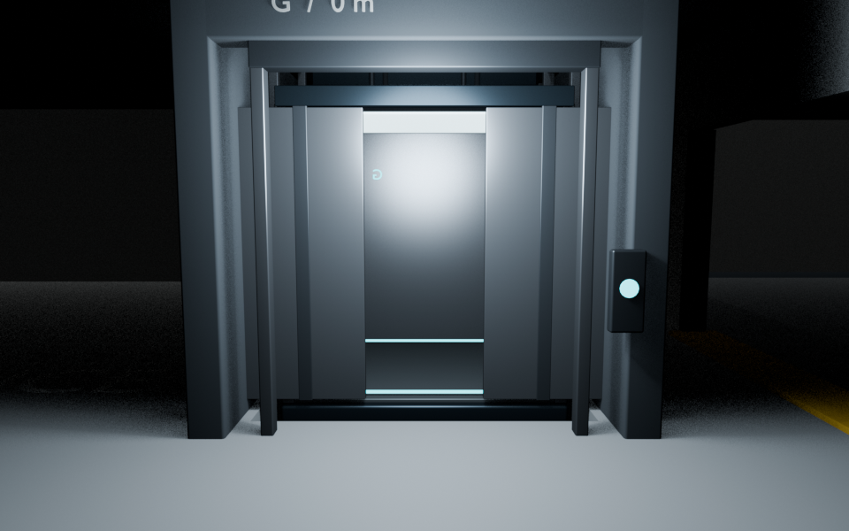
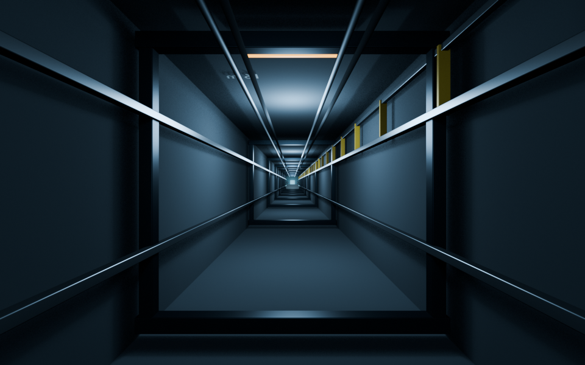
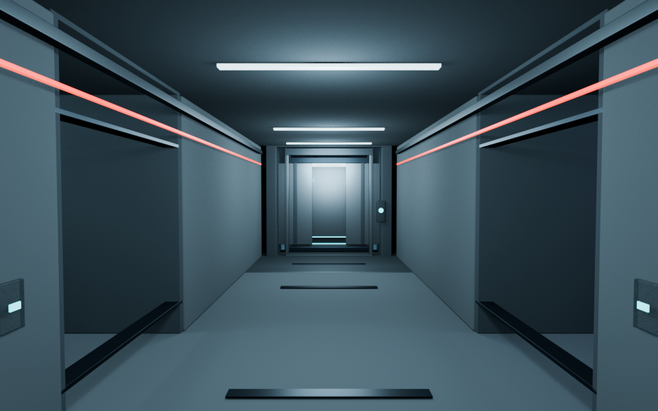
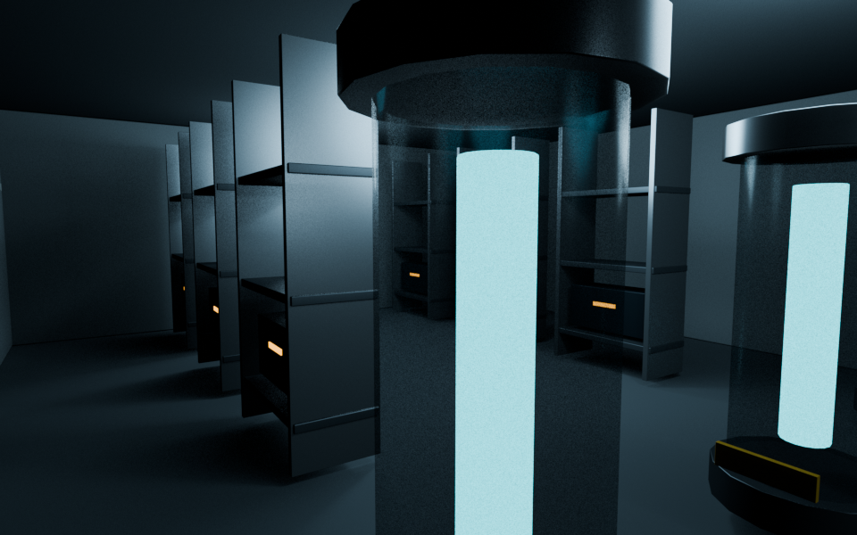
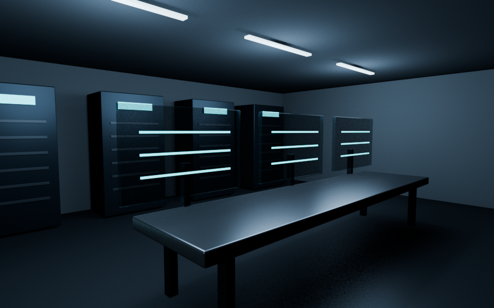

# Deep elevator and secret B4 level

This Blender scene extends the existing elevator beside Maintenance 17 with an 82 m shaft. It adds guide rails, inspection bays, cable runs, ladder, buffers, machinery, lit portals, and an animated stainless car. At B4, a service corridor conceals two rooms behind sliding wall panels: a specimen archive and a surveillance suite.

## Open the scene

Download or clone the repository, then run:

```sh
python blender/deep_elevator/restore.py
```

The script joins four numbered parts and checks their SHA-256 hashes. Open the resulting `blender/deep_elevator/Chimera_Warehouse_Deep_Elevator.blend` in Blender.

The elevator is at ground level at frame 1, arrives at B4 by frame 246, and the hidden panels open by frame 280. The saved scene opens at frame 280 with the B4 corridor camera. The build script is included for further edits.

## Preview views






